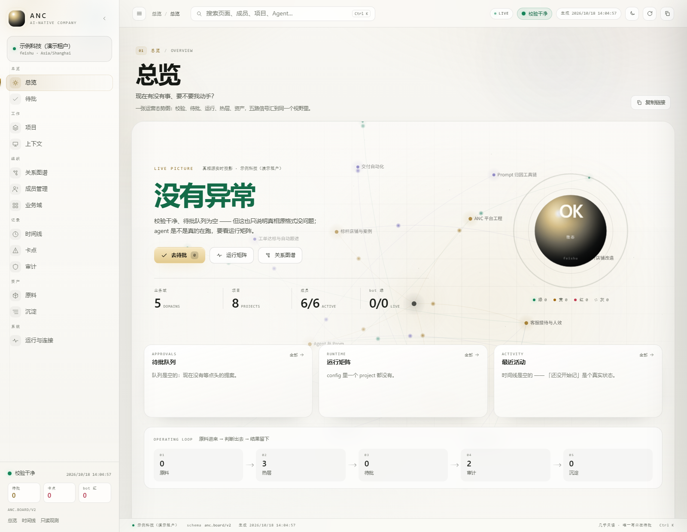
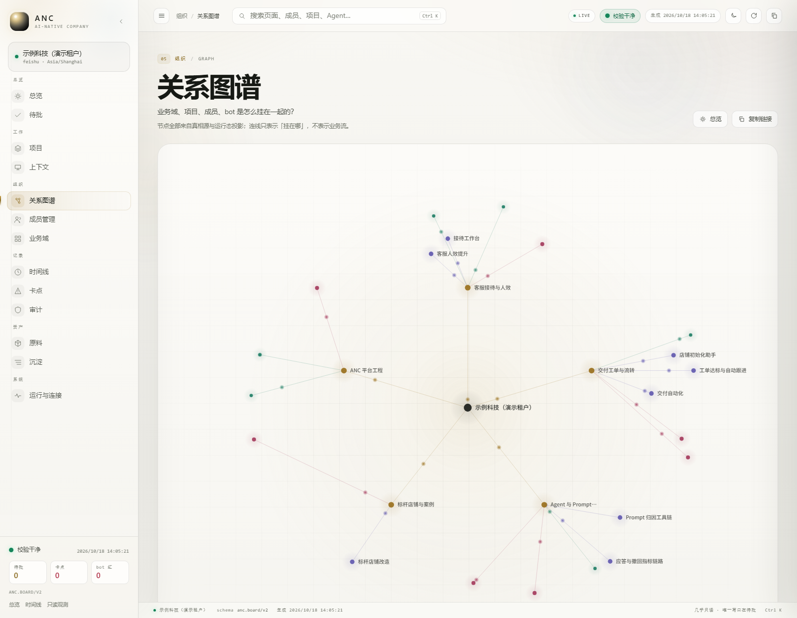
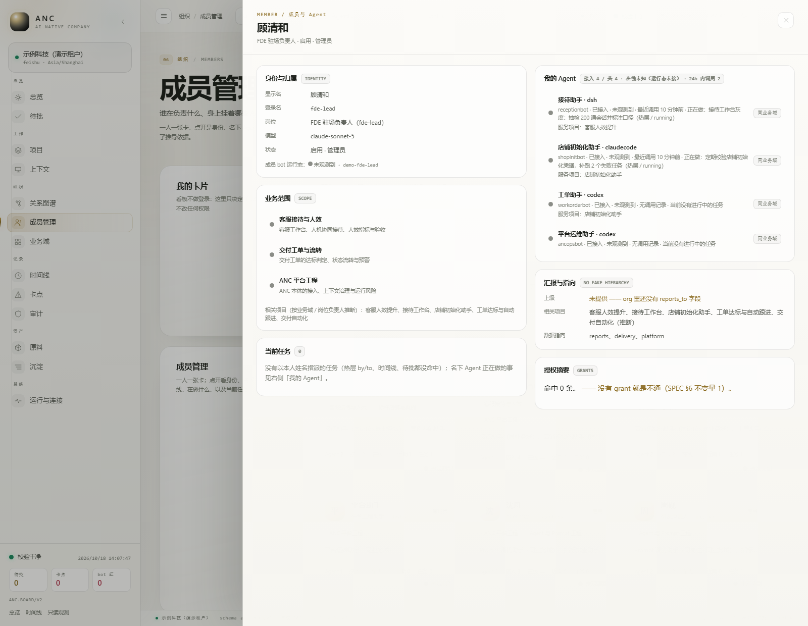

# ANC 看板交付效果（V0.1，2026-10-18）

这组图只回答一件事：**当前这版 ANC 看板到底跑通了哪些能力**。

## 代表画面

## 脱敏说明

- 全部数据来自虚构的「示例科技（演示租户）」，不对应任何真实公司、客户、人员、项目或内部系统。
- 没有真实姓名或真实飞书 `open_id` / `app_id` / `app_secret`、token、内网地址或客户凭据；演示里的 `ou_test_*` / `cli_demo_*` 全是虚构值。
- 项目 `source` 全部是 `demo://...` 指针；审计里只有两条演示用的只读调用。
- 演示真相源在 `runtime/testdata/demo-public/vault/`，可以重新起一份同样的看板。

## 能力清单

| 截图 | 这页证明什么 |
|---|---|
| `01-overview.png` | 五路信号汇到一屏：校验、待批、运行、热层、审计；没有异常时不伪造忙碌 |
| `02-graph.png` | 公司 → 业务域 → 项目 / 成员 / Agent 的挂载关系；连线只表示「挂在哪」，不冒充业务流 |
| `03-domains.png` | 一块业务是什么、谁在做、数据在哪、来源与术语边界 |
| `04-projects.png` | 项目负责人、周期原文、周期时间消耗；交付进度没有真相源就明确留白 |
| `05-members.png` | 一人一张卡：名下 Agent 总数 / 接入数 / 在线状态 / 24h 调用 / 当前任务 |
| `06-member-drawer.png` | 成员抽屉：身份、业务范围、我的 Agent、正在做的事、汇报指向、授权摘要 |
| `07-hot.png` | 热层里还没落库的当前态：3 条进行中任务、谁在做、交给谁、多久没动、新鲜度 |
| `08-audit.png` | 审计流水：谁在什么时候、对什么、行使了什么、结果落在绿 / 红 / 灰哪一档 |

## 明确边界

- 当前是 **V0.1**，不是可交付客户的生产版本。
- 演示租户没有真实 harness 心跳，所以「在线」显示 **未观测**；审计里的「最近调用」不等于「此刻在线」，看板没有混用。
- 项目只展示「周期时间消耗」，没有「交付进度」真相源，因此不画假进度条。
- `org` 还没有 `reports_to` 字段，成员抽屉里的「上级」明确写「未提供」，不猜组织汇报线。
- 报告自动抽取、冲突检测、per-agent token、真实多租户隔离仍未完成。

## 截图口径

视口 `1600 × 1240`，浅色主题，Chromium headless，`--force-device-scale-factor=1`。页面依次为：

`#/overview`、`#/graph`、`#/domains`、`#/projects`、`#/members`、`#/members?who=fde-lead&open=fde-lead`、`#/system?tab=hot`、`#/audit`。

## 复现

见 `runtime/testdata/demo-public/README.md`。热层是执行面的当前态，需要本机 Redis；没有 Redis 时热层为空，其余页面照常。
